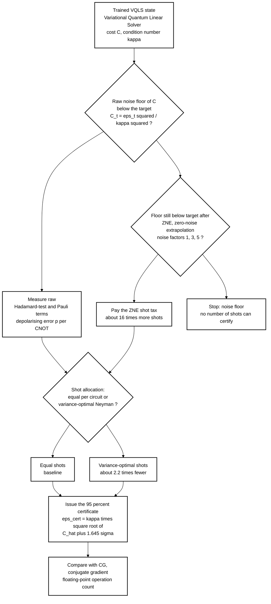
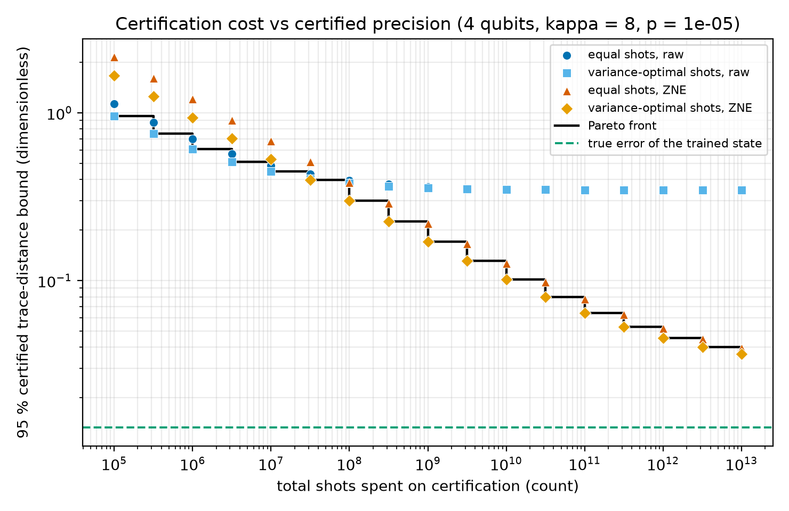
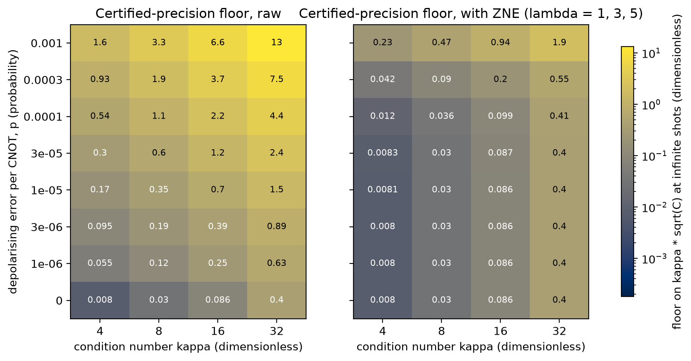
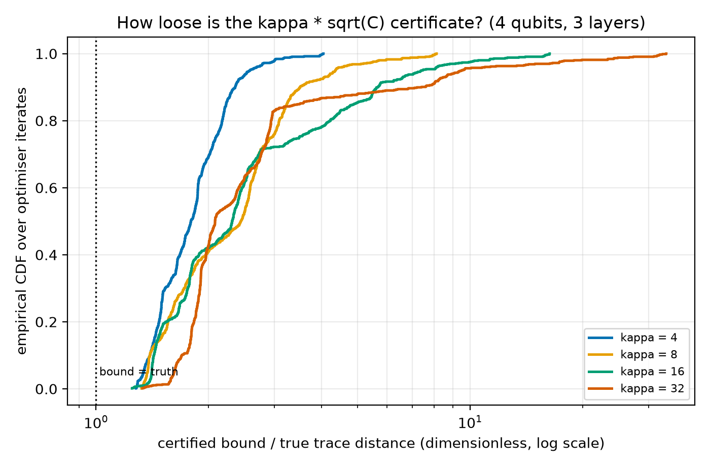
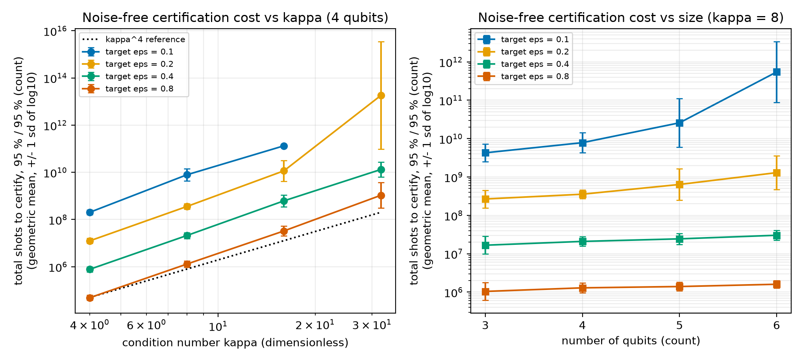
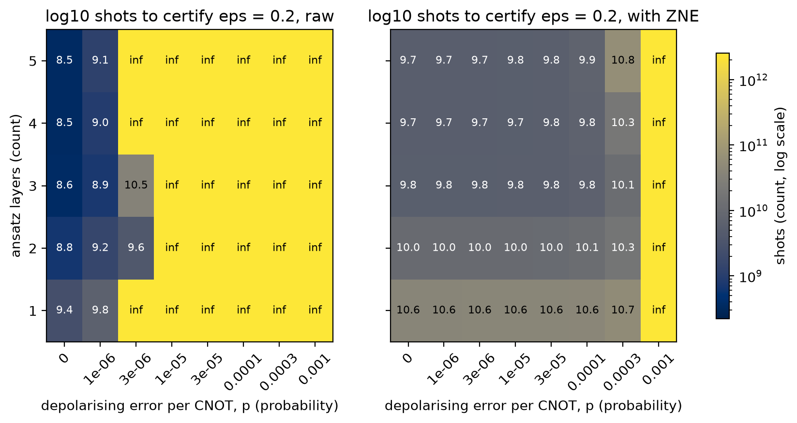

# Can a Variational Quantum Linear Solver Prove Its Own Answer? Shot Cost and Noise Floor of the Precision Certificate


[](LICENSE)

[](pyproject.toml)

[](.github/workflows/ci.yml)


**Abstract.** The Variational Quantum Linear Solver (VQLS) comes with a proven precision guarantee, `eps <= kappa * sqrt(C)`, but nobody has priced what it costs to *evaluate* that guarantee on a noisy device. In a 3 to 6 qubit simulation with a Hadamard-test cost model, issuing a 95 % certificate for a trace-distance target of 0.2 takes about 3.6e8 shots at 4 qubits and condition number 8, the shot count grows with a log-log slope of about 4.7 in the condition number, and a raw certificate stops working once the error per two-qubit gate exceeds about 3e-6. Zero-noise extrapolation (ZNE) pushes that limit to 3e-4 at a 15.7-fold shot tax, variance-optimal shot allocation saves a further factor of 2.2, and a classical conjugate-gradient (CG) solve needs only about 2e3 floating-point operations for the same system.


## Motivation


Variational linear solvers are being used inside scientific codes (nonlinear elasticity, transport models), and the reviews flag scalability and the cost of trusting near-term results as open problems. The one guarantee VQLS offers is a bound that turns the cost value `C` into a precision claim. Near the optimum `C` is tiny (here 6e-6 to 2.5e-4, mean over seeds), the quantity being estimated is `1 - beta^2 / delta`, a difference of two nearly equal noisy numbers, and its shot noise does not shrink as `C` does. The question for this study: **how many shots, and how clean a device, does it take to turn the bound into an issued certificate, and is it ever cheaper than just solving the system classically?**


## Research gap (details and related-work table in [`docs/RESEARCH_GAP.md`](docs/RESEARCH_GAP.md))


- Bravo-Prieto et al., 2023 (doi:10.22331/q-2023-11-22-1188) prove `C >= eps^2 / kappa^2` but do not price the estimation of `C`.

- Kim et al., 2023 (doi:10.1038/s41567-022-01914-3) show ZNE for expectation values; the VQLS cost is a nonlinear ratio of two such values.

- Kouskiya and Oskay, 2027 (doi:10.1016/j.cma.2026.119443) and Ying et al., 2027 (doi:10.1016/j.jocs.2026.103048) apply variational and hybrid solvers to physical problems and report accuracy, not certified precision.

- Alzboun and Abed-alguni, 2027 (doi:10.1016/j.ins.2026.124009) and Huynh et al., 2027 (doi:10.1016/j.cosrev.2026.101072) call for diagnosing why quantum methods fall short and for scalability analysis.


## Hypotheses


- **H1** the bound is never violated; **H2** shots to certify scale about like `kappa^4` (falsified if the slope is below 3); **H3** the raw certificate hits a noise floor that ZNE moves up by at least 10x; **H4** certification alone costs orders of magnitude more operations than the classical solve.


## What is new here


- A priced certificate: total shots at 95 % confidence and 95 % issue probability, derived by delta-method moments and checked against binomial shot simulation.

- A noise floor for the certificate itself (the best precision any number of shots can certify), mapped over error rate and condition number, with and without ZNE.

- A variance-optimal (Neyman) shot allocation across the Hadamard-test and Pauli circuits, compared with equal shots, plus a depth ablation that shows the trade-off between a better ansatz and more noise.


## Method at a glance





Legend: CNOT is the Controlled-NOT two-qubit gate; `eps` is the trace distance to the exact solution; `sigma` is the delta-method standard deviation of the cost estimate. Left branch of the first diamond is "yes", the other branch is "no".


Summary (full detail in [`docs/METHOD.md`](docs/METHOD.md)). The linear system is a shifted transverse-field Ising operator `A` (norm 1, condition number `kappa` set exactly) with a random product-state right-hand side. The baseline quantum method is the standard VQLS: real hardware-efficient ansatz, global cost, exact parameter-shift gradients, limited-memory Broyden-Fletcher-Goldfarb-Shanno (L-BFGS) training in noise-free statevector simulation. Certification then works on the trained state: the cost is split into measurable terms, the estimator variance is computed exactly, and noise enters as a global depolarising damping per CNOT with an explicit gate count (Toffoli = 6 CNOT, no routing). The classical baseline is CG on the sparse matrix, counted in floating-point operations.


## Experiments and outcomes


1. **Is the bound safe?** Yes. Across all 7132 optimiser iterates, `eps_true <= kappa * sqrt(C)` holds with a worst excess of 3.9e-8, found at 4 iterates whose cost was already below 2.3e-16 (double-precision resolution of the trace distance); with a 1e-7 tolerance the valid fraction is 1.0 (strict: 0.9994). H1 is supported.

2. **How loose is it?** The certificate overstates the true error by a median factor of 1.79 (kappa = 4) to 2.44 (kappa = 8) over the optimisation, and by 1.77 ± 0.43 (kappa = 4), 2.41 ± 0.79 (8), 2.46 ± 1.38 (16) and 2.00 ± 0.56 (32) for the final states. A user pays for a guarantee that is about twice as pessimistic as the truth.

3. **What does it cost without noise?** See the table below. At a fixed target the cost grows steeply with `kappa`: fitted log-log slopes are 4.74 ± 0.23 (target 0.1), 4.73 ± 0.14 (0.4) and 4.79 ± 0.18 (0.8), above the `kappa^4` I expected because the achieved cost `C` also grows with `kappa` at fixed ansatz depth. At fixed `kappa = 8` the shots fall by a factor of about 16 for every doubling of the target (1.3e6 at 0.8, 2.1e7 at 0.4, 3.6e8 at 0.2), matching an inverse fourth power. H2 is supported. The target 0.2 slope (6.4 ± 0.7) is inflated because some seeds sit close to their ansatz floor.

4. **What does noise do?** In this model it only raises `C`, so a noisy raw certificate stays valid but becomes too pessimistic to issue: the raw run at `p = 1e-5` had Monte Carlo coverage 1.000. The tolerable error rate for a target of 0.2 at `kappa = 8` is `p = 3e-6` raw and `p = 3e-4` with ZNE, a factor of 100. H3 is supported.

5. **What does ZNE cost?** At `p = 0` it needs 15.7 times more shots than the raw estimate (3.6e8 raw, 5.6e9 with ZNE at target 0.2), because three noise levels are measured and the extrapolation weights inflate the variance by 5.2. At `p = 1e-5` and target 0.4 the two are nearly even (3.3e8 raw against 3.4e8 with ZNE, equal shots, mean over seeds). Mitigation helps only where the raw floor is the binding constraint.

6. **Does smarter shot allocation help?** Yes, modestly and more at larger size: 2.17 ± 0.26 times fewer shots overall, rising from 1.71 (3 qubits) to 2.75 (6 qubits).

7. **Does a deeper ansatz help?** Noise-free, yes (cost 5.9e-4 at 1 layer to 2.1e-10 at 5 layers). Under noise, no: with raw measurement at `p = 3e-6` depth 3 needs 3.9e10 shots, depth 2 needs 2.6e12, and depths 1, 4 and 5 cannot certify at all, and with ZNE at `p = 3e-4` the shots rise from 1.2e10 (depth 3) to 6.0e10 (depth 5).

8. **Is any of this an advantage?** No. CG reaches the same accuracy in 5.0 to 6.4 iterations (2.1e3 to 2.7e3 floating-point operations), while certification alone costs 4e8 to 3.7e11 CNOT executions at `kappa` 4 to 16. H4 is supported.


## Results


All values are from `results/summary.json` and the files next to it. Shots are total shots at 95 % confidence, issued with 95 % probability, noise-free, equal allocation, 5 seeds, geometric mean (multiplicative standard deviation in brackets; "floor" means the trained ansatz is not accurate enough to certify the target for that seed).


**Shots to certify vs condition number (4 qubits, 3 layers)**


| kappa | target 0.1 | target 0.2 | target 0.4 | target 0.8 |

|---|---|---|---|---|

| 4 | 2e+08 (x/÷ 1.27) | 1.2e+07 (x/÷ 1.27) | 7.8e+05 (x/÷ 1.28) | 4.8e+04 (x/÷ 1.28) |

| 8 | 7.8e+09 (x/÷ 1.83) | 3.6e+08 (x/÷ 1.31) | 2.1e+07 (x/÷ 1.33) | 1.3e+06 (x/÷ 1.35) |

| 16 | 1.3e+11 (x/÷ 1.13), 3 of 5 seeds | 1.2e+10 (x/÷ 2.76), 4 of 5 seeds | 6.2e+08 (x/÷ 1.78) | 3.3e+07 (x/÷ 1.62) |

| 32 | floor (0 of 5 seeds) | 1.8e+13 (x/÷ 191.8), 3 of 5 seeds | 1.3e+10 (x/÷ 2.06), 3 of 5 seeds | 1.1e+09 (x/÷ 3.41), 4 of 5 seeds |


**Shots to certify vs number of qubits (kappa = 8, 3 layers)**


| qubits | target 0.1 | target 0.2 | target 0.4 | target 0.8 |

|---|---|---|---|---|

| 3 | 4.3e+09 (x/÷ 1.70) | 2.7e+08 (x/÷ 1.70) | 1.7e+07 (x/÷ 1.70) | 1e+06 (x/÷ 1.70) |

| 4 | 7.8e+09 (x/÷ 1.83) | 3.6e+08 (x/÷ 1.31) | 2.1e+07 (x/÷ 1.33) | 1.3e+06 (x/÷ 1.35) |

| 5 | 2.6e+10 (x/÷ 4.29), 4 of 5 seeds | 6.4e+08 (x/÷ 2.57) | 2.4e+07 (x/÷ 1.39) | 1.4e+06 (x/÷ 1.30) |

| 6 | 5.5e+11 (x/÷ 6.24), 2 of 5 seeds | 1.3e+09 (x/÷ 2.73) | 3e+07 (x/÷ 1.34) | 1.6e+06 (x/÷ 1.25) |


**Noise floor on the certified precision at infinite shots (4 qubits, kappa = 8, mean ± standard deviation over 5 seeds)**


| error per CNOT, p | raw | with ZNE |

|---|---|---|

| 0 | 0.030 ± 0.028 | 0.030 ± 0.028 |

| 1e-6 | 0.115 ± 0.009 | 0.030 ± 0.028 |

| 3e-6 | 0.192 ± 0.006 | 0.030 ± 0.028 |

| 1e-5 | 0.346 ± 0.003 | 0.030 ± 0.028 |

| 1e-4 | 1.08 ± 0.001 | 0.036 ± 0.024 |

| 3e-4 | 1.86 ± 0.002 | 0.090 ± 0.012 |

| 1e-3 | 3.29 ± 0.003 | 0.469 ± 0.002 |


**Quantum certificate against classical solve (target 0.2, noise-free)**


| kappa | CG iterations | CG floating-point operations | CNOT executions to certify (geometric mean) |

|---|---|---|---|

| 4 | 5.2 ± 1.3 | 2163 | 4e+08 |

| 8 | 5.8 ± 1.6 | 2413 | 1.1e+10 |

| 16 | 6.4 ± 2.2 | 2662 | 3.7e+11 (4 of 5 seeds) |

| 32 | 5.0 ± 1.0 | 2080 | 5.9e+14 (3 of 5 seeds) |


**Validation of the formula.** Binomial shot simulation (4000 repeats, `results/monte_carlo_validation.csv`) at the predicted shot counts gave certificate issue rates of 0.945, 0.9545, 0.948 and 0.952 against the nominal 0.95, and coverage of 0.950, 0.947, 1.000 (raw with noise, conservative) and 0.951.


**Figure 1.** 

Takeaway: at `p = 1e-5` the raw certificate flattens near 0.35 no matter how many shots are spent, while ZNE keeps improving and defines the Pareto front from roughly 1e8 shots on.


**Figure 2.** 

Takeaway: the raw floor rises with both error rate and condition number, and ZNE removes most of the rise up to about `p = 1e-4`.


**Figure 3.** 

Takeaway: the bound is never below the truth and is typically 1.5 to 3 times too pessimistic, with a long tail at larger `kappa`.


**Figure 4.** 

Takeaway: shot cost climbs with a slope of about 4.7 in `kappa` but is almost flat in qubit number at loose targets.


**Figure 5.** 

Takeaway: the extra accuracy of a deeper ansatz is paid back in noise; depth 3 is the sweet spot for raw measurement here.


## Discussion, including what did not work


- The certificate is cheap to state and expensive to issue: 3.6e8 shots for a precision claim of 0.2 on a 16-dimensional system whose true error is about 0.013. That is a negative result for the practicality of variational solves as *verified* subroutines at this noise level.

- The expected `kappa^4` law is a lower-bound intuition; measured slopes are about 4.7 because the ansatz does not keep up with harder systems at fixed depth. Seeds 3 of 5 certify at `kappa = 32` for loose targets only; the geometric mean there has a multiplicative spread of 191.8 and should be read as "very expensive", not as a precise number.

- ZNE is not free. Below `p` of about 1e-5 it is a pure shot tax; its value is in extending the usable noise range by two orders of magnitude.

- Variance-optimal allocation is a modest, reliable gain (2.17x), not a game changer, because the dominant cost is the near-cancellation in `C`, not an unlucky split of shots.

- The classical baseline wins by about 10^7.5 in operations at these sizes (geometric mean over the 17 of 20 cases that can be certified). No quantum advantage is claimed or suggested; the study only asks what a quantum solver would have to pay to prove itself.


## Limitations


- Simulation only, 3 to 6 qubits, matrix sizes 8 to 64, 5 seeds. Instances are one problem family (Ising-type, real, norm 1).

- Noise is an analytic global-depolarising damping per CNOT, with an assumed gate count (all-to-all connectivity, Toffoli = 6 CNOT). Real noise is local, correlated and drifting; ZNE would be less effective than here, and the exponential noise form flatters Richardson extrapolation.

- Training is noise-free and its shots are not charged; only the certification of the trained state is priced. Training under noise would give a different state.

- Shot counts use exact delta-method moments (validated by Monte Carlo at four settings), not full shot-by-shot optimisation runs.

- The "operations" comparison mixes CNOT executions with floating-point operations; it shows an order of magnitude gap, not an exact exchange rate.


## Future work


On hardware, the same accounting can be run with measured per-gate errors from a calibration snapshot and a transpiled gate count in place of the assumed one. Cheaper certificates look promising: local cost functions, shared-measurement grouping of commuting Paulis, and tighter bounds than `kappa * sqrt(C)` would each cut the shot count. A scale-up to 20 or more qubits would need tensor-network or sparse simulation of the term means, which the code structure already isolates. For a lab with access to quantum processors, the interesting experiment is to measure the noise floor of the certificate directly on a 4 to 6 qubit instance and compare it with this model.


## Related work by the author


- [`shot-fair-damped-qng-vqe-benchmark`](https://github.com/pradeepdegalaroyal/shot-fair-damped-qng-vqe-benchmark): the same shot-charging discipline applied to variational eigensolver optimisers.

- [`QEM-ZeroNoise-Extrapolation`](https://github.com/pradeepdegalaroyal/QEM-ZeroNoise-Extrapolation): zero-noise extrapolation experiments, whose mitigation idea is reused here on a nonlinear cost.


## Reproducibility


```bash

pip install -r requirements.txt

python -m pytest -q                          # 8 fast tests

python experiments/run_all.py --quick        # smoke run, about 16 s, writes results_quick/ and figures_quick/

python experiments/run_all.py                # full study, writes results/ and figures/

```


Full run: 310 s on Windows 11 with a 16-thread central processing unit (CPU), 4 worker processes, Python 3.11.9; no graphics processor is used. Dependencies are pinned in `requirements.txt` (NumPy 2.2.6, SciPy 1.17.1, pandas 2.3.3, Matplotlib 3.11.1). Every number above is read from `results/summary.json`, `results/noise_floor.csv`, `results/shots_to_certify.csv` and `results/monte_carlo_validation.csv`.


## Project structure


```

src/vqls_cert/   problem.py (instances), ansatz.py, cost.py (cost, gradient, terms, training),

                 certify.py (moments, shots, noise, ZNE, Monte Carlo), classical.py (CG),

                 pipeline.py (sweeps), plotting.py

experiments/run_all.py   one-command reproduction

tests/                   8 fast tests

docs/                    RESEARCH_GAP.md, METHOD.md

results/  figures/       raw tables and figures

.github/workflows/ci.yml tests and smoke run on ubuntu-latest

```


## Citation


```bibtex

@software{degala2026vqlscert,

  author  = {Degala, Chenchupradeep},

  title   = {Shot and Noise Cost of Certifying Variational Quantum Linear Solver Precision},

  year    = {2026},

  version = {0.1.0},

  url     = {https://github.com/pradeepdegalaroyal/vqls-certificate-shot-cost-noise-floor},

  license = {MIT}

}

```


MIT license (`LICENSE`). Machine-readable citation metadata is in `CITATION.cff`.

